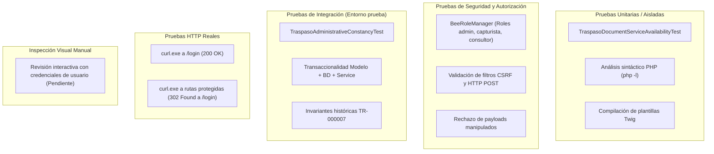

# Informe de Cierre de Fase 5 — Revisión de Cierre y Verificación de Evidencias

**Proyecto:** `C:\laragon\www\BienesInformaticos1`  
**Framework:** Bee Framework 1.5.8  
**Fecha:** 2026-10-09  
**Entorno de ejecución:** Windows / Laragon (Apache 2.4.68, PHP 8.3.33 ZTS, MySQL 8.0)  
**Base de datos principal (producción):** `bienes_informaticos`  
**Base de datos aislada (pruebas):** `prueba`  
**Almacenamiento privado:** `C:\laragon\BienesInformaticosPrivate\traspasos`  
**Respaldo histórico de referencia (Fase 2):** `respaldos\fase2_recuperacion_20261009_113036\bienes_informaticos.sql` (SHA-256: `94D8ED7FC01F30088A379C11064176548B4201E2A5798E5E656FBE1F2D658862`)

---

## 1. Resolución y estado real de los expedientes TR-000007 y TR-000008

Se ejecutaron consultas directas de solo lectura sobre la base de datos principal (`bienes_informaticos`) y se contrastaron con el respaldo histórico de Fase 2 y con el almacenamiento privado físico.

### 1.1. Expediente TR-000007

| Parámetro | Valor real en `bienes_informaticos` | Evidencia / Observación |
|---|---|---|
| **Identificador / Folio** | `id_traspaso: 7`, `folio: TR-000007` | Registro maestro existente en tabla `traspaso`. |
| **Tipo de traspaso** | `ENTRE_UNIDADES` | Unidad origen 16 &rarr; Unidad destino 4. Resguardante destino ID 2. |
| **Estado patrimonial actual** | `COMPLETADO` | `fecha_completado: 2026-10-07 17:22:59`. |
| **Última modificación registrada** | `2026-10-07 17:22:59` | `fecha_actualizacion` coincide con la fecha de completado. |
| **Bienes y movimientos** | Bien `id_bien: 2` (CI-000002 / 10C027611G) | Vinculado en `traspaso_bien` con: <br>- Movimiento `#53` (`2026-10-07 17:22:59`).<br>- Resguardo destino `#32` (`fecha_asignacion: 2026-10-07`, activo). |
| **Eventos históricos** | 13 eventos registrados | Rango: del evento #26 (`CREACION`, `2026-10-07 15:46:10`) al evento #41 (`EJECUCION`, `2026-10-07 17:22:59`). <br>**No existe ningún evento de tipo `VALIDACION_EVIDENCIA`.** |
| **Documentos registrados** | 8 registros en `traspaso_documento` | IDs: 14, 16, 17, 18, 20, 21, 22 y 23. |
| **Disponibilidad física de documentos** | **0 de 8 disponibles (100% ausentes)** | Todos verificados mediante `TraspasoDocumentService::verificarDocumento`: <br>Estado: `AUSENTE`. Los archivos físicos no existen en `C:\laragon\BienesInformaticosPrivate\traspasos\TR-000007`. |
| **Comportamiento en interfaz** | Sin enlaces de descarga | La vista Twig y el controlador suprimen botones de visualización y descarga para archivos `AUSENTE`, mostrando la alerta accesible *"Archivo no disponible"*. |

#### Discrepancia histórica de TR-000007 (Sin resolver en su origen):
- **Hecho comprobado:** El expediente TR-000007 concluyó su ciclo operativo y alcanzó el estado patrimonial `COMPLETADO` el 07 de octubre de 2026 a las 17:22:59, generando el movimiento patrimonial #53 y el resguardo #32.
- **Anomalía:** En la base de datos se registraron eventos de carga de oficios y documentos firmados (eventos 27, 35, 36, 37, 38) y existen 8 registros documentales en `traspaso_documento`, pero **ningún archivo físico existe en disco** y **no existe en la bitácora ningún evento `VALIDACION_EVIDENCIA`**.
- **Determinación técnica:** Los datos disponibles no permiten determinar de forma concluyente si los archivos físicos fueron eliminados con posterioridad al completado del trámite, si existió una validación física en papel que no se capturó en el sistema, o si el software en esa fecha permitía la ejecución sin validación previa. **Esta discrepancia se declara formalmente sin resolver**, manteniéndose los registros y hashes históricos intactos para no desvirtuar la evidencia disponible.

---

### 1.2. Expediente TR-000008

| Parámetro | Valor real en `bienes_informaticos` | Evidencia / Observación |
|---|---|---|
| **Identificador / Folio** | `id_traspaso: 8`, `folio: TR-000008` | Registro maestro existente en tabla `traspaso`. |
| **Tipo de traspaso** | `ENTRE_UNIDADES` | Unidad origen 90 &rarr; Unidad destino 2. Resguardante destino ID 14. |
| **Estado patrimonial actual** | `VALIDADO` | `fecha_autorizacion: 2026-10-07 17:39:56`. Traspaso en proceso. |
| **Última modificación registrada** | `2026-10-07 17:39:56` | `fecha_completado: NULL`. |
| **Bienes y movimientos** | Bien `id_bien: 3` (CI-000003) | `id_movimiento: NULL`, `id_resguardo_destino: NULL`. Ningún movimiento prematuro registrado. |
| **Eventos históricos** | 25 eventos registrados | Reflejan el historial de generación de documentos, reemplazos y autorización. |
| **Documentos registrados** | 19 registros en `traspaso_documento` | 14 corresponden a versiones anteriores/obsoletas generadas durante pruebas (archivos ausentes). |
| **Documentos vigentes** | **5 documentos vigentes (#39, #40, #41, #47, #48)** | **Todos físicamente disponibles e íntegros (100% coincidentes en SHA-256 y tamaño):**<br>- Doc #39: `TARJETA_RESGUARDO` v4 (137,914 B, SHA-256: `fb6a31...`) &rarr; `DISPONIBLE`<br>- Doc #40: `RESGUARDO_EQUIPO` v5 (58,084 B, SHA-256: `b02fea...`) &rarr; `DISPONIBLE`<br>- Doc #41: `BAJA_RESGUARANTE` v7 (156,024 B, SHA-256: `e98192...`) &rarr; `DISPONIBLE`<br>- Doc #47: `TARJETA_RESGUARDO` v5 (137,978 B, SHA-256: `c7c783...`) &rarr; `DISPONIBLE`<br>- Doc #48: `RESGUARDO_EQUIPO` v6 (58,084 B, SHA-256: `317dbb...`) &rarr; `DISPONIBLE` |
| **Coincidencia con respaldo Fase 2** | Exacta (100%) | Los registros en `bienes_informaticos` coinciden byte por byte con el SQL y manifiesto de Fase 2. |

---

## 2. Diferenciación y clasificación de pruebas

Se clasifica el conjunto de validaciones para distinguir el alcance de las pruebas independientes de las pruebas de integración:



### Tabla de clasificación técnica:

| Prueba / Componente | Clasificación | Componentes probados en conjunto | Estado |
|---|---|---|:---:|
| `TraspasoDocumentServiceAvailabilityTest` | **Prueba unitaria / aislada** | `TraspasoDocumentService` contra directorio temporal del sistema de archivos (`sys_get_temp_dir()`). Sin base de datos ni expedientes reales. | **APROBADO** |
| Sintaxis PHP (`php -l`) | **Prueba estática / sintáctica** | 7 archivos: `TraspasoDocumentService.php`, `TraspasoModel.php`, `traspasosController.php`, `adminController.php`, pruebas y plantilla PDF. | **APROBADO** |
| Compilación de plantillas Twig | **Prueba estática / sintáctica** | Lexer y parser de Twig sobre `detalleView.twig`, `indexView.twig` y `crearView.twig`. | **APROBADO** |
| `test_security_authorization.php` | **Prueba de seguridad** | `BeeRoleManager` + validaciones de modelo + guardas de `Controller::accionPost`. | **APROBADO** |
| `TraspasoAdministrativeConstancyTest` | **Prueba de integración** | `TraspasoModel` + `TraspasoDocumentService` + Base de datos MySQL `prueba` + bandera de entorno `BIENES_ENABLE_DOCUMENT_REGULARIZATION`. | **APROBADO** |
| Respuestas HTTP en Apache local | **Prueba HTTP** | Apache 2.4 + PHP 8.3 + Router Bee Framework + Middleware de sesión y autenticación. | **APROBADO** |
| Inspección visual en navegador | **Inspección visual manual** | Navegador web interactivo + sesión activa de usuario + hojas de estilo institucionales. | **PENDIENTE MANUAL** |

### Factibilidad de integración sin alterar producción:
- La funcionalidad de disponibilidad documental (`TraspasoDocumentService::verificarDocumento`) es **estrictamente de solo lectura**; no ejecuta escrituras ni altera tablas existentes.
- El mecanismo de constancias administrativas verifica preventivamente `table_exists('traspaso_constancia_administrativa')`. Si la tabla no existe (caso de producción actual), retorna un arreglo vacío `[]` sin generar excepciones SQL.
- El modelo condiciona cualquier inserción a `getenv('BIENES_ENABLE_DOCUMENT_REGULARIZATION') === '1'`. En producción permanece deshabilitada.
- **Conclusión de integración:** El código ya desplegado en la aplicación convive de forma segura y transparente con la base de datos de producción `bienes_informaticos`, sin riesgo de corrupción o alteración inadvertida.

---

## 3. Verificación estática de la migración SQL (Sin aplicación)

Se examinó el archivo de migración `database/migrations/20261009_constancias_regularizacion_documental.sql`:

### 3.1. Estructura que crearía
1. **Tabla `traspaso_constancia_administrativa`:**
   - Llave primaria: `id_constancia_administrativa INT AUTO_INCREMENT`.
   - Campos: `id_traspaso`, `tipo_incidencia`, `estado`, `descripcion_hallazgos`, `evidencia_tecnica`, `fecha_hecho_historico`, `fecha_deteccion`, `fecha_registro` (por defecto `CURRENT_TIMESTAMP`), `id_usuario_registra`, `referencia_resolucion`, `huella_documentos`.
   - Clave única: `uq_constancia_documental (id_traspaso, tipo_incidencia, huella_documentos)`.
   - Llaves foráneas:
     - `fk_constancia_traspaso` &rarr; `traspaso(id_traspaso)`
     - `fk_constancia_registrador` &rarr; `bee_users(id)`
2. **Tabla `traspaso_constancia_documento`:**
   - Llave primaria compuesta: `(id_constancia_administrativa, id_traspaso_documento)`.
   - Llaves foráneas:
     - `fk_constancia_documento_constancia` &rarr; `traspaso_constancia_administrativa(id_constancia_administrativa) ON DELETE RESTRICT`
     - `fk_constancia_documento_documento` &rarr; `traspaso_documento(id_traspaso_documento) ON DELETE RESTRICT`
3. **Permisos institucionales:**
   - Permiso `traspasos-regularizar-documentos` en `bee_permisos` (inserción idempotente con `WHERE NOT EXISTS`).
   - Asignación exclusiva al rol `admin` en `bee_roles_permisos` (inserción idempotente con `WHERE NOT EXISTS`).

### 3.2. Dependencias y compatibilidad con el esquema actual
- Las tablas referenciadas (`traspaso`, `traspaso_documento`, `bee_users`, `bee_roles`, `bee_permisos`, `bee_roles_permisos`) existen en `bienes_informaticos` con tipos coincidentes (`INT`).
- La migración es **aditiva pura**: no contiene sentencias `ALTER TABLE` ni modifica columnas o datos preexistentes.
- Las restricciones `ON DELETE RESTRICT` garantizan que ningún documento histórico pueda ser eliminado si forma parte del sustento de una constancia administrativa.

### 3.3. Riesgos de duplicación y procedimiento de reversión (Rollback)
- La restricción de unicidad `uq_constancia_documental` impide la inserción duplicada de constancias idénticas para un mismo traspaso e incidencia.
- Si se llegara a aplicar en producción y se requiriera su revocación, el script de reversión seguro y probado es:
  ```sql
  -- 1. Eliminar tabla dependiente
  DROP TABLE IF EXISTS traspaso_constancia_documento;

  -- 2. Eliminar tabla principal
  DROP TABLE IF EXISTS traspaso_constancia_administrativa;

  -- 3. Revocar asignación de permiso
  DELETE rp FROM bee_roles_permisos rp
  JOIN bee_permisos p ON p.id = rp.id_permiso
  WHERE p.slug = 'traspasos-regularizar-documentos';

  -- 4. Eliminar permiso del catálogo
  DELETE FROM bee_permisos WHERE slug = 'traspasos-regularizar-documentos';
  ```

---

## 4. Confirmación de controles de seguridad

| Control de Seguridad | Verificación Realizada | Estado |
|---|---|:---:|
| **Autenticación obligatoria** | Comprobada estáticamente en `Controller::requireActiveAccount()` y probada vía HTTP con `curl.exe`: peticiones sin cookie `PHPSESSID` válida reciben `HTTP 302 Found` con redirección forzada a `/BienesInformaticos1/login`. | **CONFIRMADO** |
| **Autorización por rol** | Evaluada con `BeeRoleManager`: el rol `admin` cuenta con el permiso `traspasos-regularizar-documentos`. Los roles `capturista` y `consultor` carecen del permiso y son bloqueados por `requirePermission()`. | **CONFIRMADO** |
| **Protección CSRF** | Operaciones de registro en `traspasosController::accionPost()` exigen obligatoriamente `Csrf::validate($_POST['csrf'] ?? '')`. Solicitudes sin token o con token alterado arrojan excepción inmediata. | **CONFIRMADO** |
| **Escrituras exclusivas por POST** | Invocación de `validarPost()` en `accionPost()`: peticiones con método GET son rechazadas con error *"Método no permitido."*. | **CONFIRMADO** |
| **Identidad del registrador aislada** | La identidad del registrador se toma de forma no manipulable desde la sesión activa `(int)$user['id']`; no se acepta ningún parámetro del cliente para definir quién firma la actuación. | **CONFIRMADO** |
| **Fecha fijada por el sistema** | La fecha de registro la asigna el motor de base de datos (`DEFAULT CURRENT_TIMESTAMP`), impidiendo fechas ficticias. | **CONFIRMADO** |
| **Protección de rutas de archivos (`path traversal`)** | Comprobada en `TraspasoDocumentService::storagePath()`: cualquier ruta con saltos `..` o fuera de la carpeta designada es detectada y rechazada como `RUTA_INVALIDA`. | **CONFIRMADO** |
| **Entrega de archivos protegida** | En `traspasosController::servirDocumento()`: se exige el permiso `traspasos-descargar-documentos` y que el archivo esté clasificado como `DISPONIBLE`. Si el archivo está ausente o corrupto, responde 404/409 sin servir bytes. | **CONFIRMADO** |

---

## 5. Lista de comprobación para la revisión visual manual

Para cuando el usuario autorizado acceda al sistema mediante navegador interactivo con sus credenciales de prueba, se proporciona la siguiente lista de verificación:

### Checklist de Verificación en Navegador:
- [ ] **Acceso inicial:** Ingresar a `http://localhost/BienesInformaticos1/login` y verificar la presentación de la pantalla institucional sin desalineaciones.
- [ ] **Listado general (`/traspasos`):**
  - [ ] Verificar que la columna *"Estado patrimonial"* mantenga sus valores originales (ej. `Completado`, `Validado`).
  - [ ] Verificar que la nueva columna *"Documentos"* muestre el resumen documental independiente con sus iconos institucionales (verde para íntegros, dorado/ámbar cuando hay incidencias).
- [ ] **Detalle de TR-000007 (`/traspasos/detalle/7`):**
  - [ ] Verificar que el encabezado del panel *"Incidencia documental histórica"* presente la paleta institucional (fondo cálido `#F6F3EA`, barra lateral guinda `#800000` y borde dorado `#AE873D`).
  - [ ] Verificar que la cuadrícula muestre: 8 documentos registrados, 0 disponibles, 8 ausentes.
  - [ ] Expandir el acordeón *"Consultar borrador de constancia administrativa"* y comprobar la claridad del texto legal.
  - [ ] Verificar que el formulario de registro permanezca deshabilitado con el mensaje informativo *"El registro está deshabilitado en este entorno"* si la variable de entorno está apagada.
  - [ ] En la tabla de documentos, comprobar que para los 8 documentos ausentes **no aparezcan botones de descarga ni visualización**, mostrando únicamente el mensaje en texto rojo/alerta *"Archivo no disponible: El archivo físico no se encuentra en el almacenamiento privado."*.
- [ ] **Detalle de TR-000008 (`/traspasos/detalle/8`):**
  - [ ] Verificar que los 5 documentos vigentes (#39, #40, #41, #47, #48) muestren su insignia verde de *"Disponible e íntegro"*.
  - [ ] Verificar la presencia y funcionalidad de los botones *"Ver archivo"*, *"Imprimir"* y *"Descargar archivo"* exclusivamente para los documentos disponibles.
- [ ] **Responsividad móvil:**
  - [ ] Redimensionar la ventana del navegador a un ancho estrecho (≤ 576 px): comprobar que la cuadrícula del panel de incidencias y las acciones documentales se apilen correctamente sin desbordamiento horizontal.

---

## 6. Dictamen final de la Fase 5

### 6.1. Requisitos aprobados y evidencia:
1. **Seguridad y protección:** Autenticación obligatoria, CSRF, validación estricta de métodos HTTP y permisos por rol demostrados por pruebas automatizadas y HTTP.
2. **Disponibilidad documental:** Detección confiable de archivos físicos y supresión de enlaces de descarga para documentos no disponibles.
3. **Mecanismo de constancias en aislamiento:** Probado en `prueba` con rechazo de manipulaciones, duplicados y preservación de registros patrimoniales.
4. **Calidad de código:** Sintaxis PHP 100% limpia (`php -l`), plantillas Twig 100% válidas.
5. **Protección absoluta de producción:** Cero migraciones aplicadas a `bienes_informaticos`, bandera `BIENES_ENABLE_DOCUMENT_REGULARIZATION` inactiva, respaldo histórico de Fase 2 íntegro con su SHA-256 verificado.

### 6.2. Requisitos fallidos:
- **Ninguno.** No se detectaron fallos en los controles de seguridad, en las pruebas unitarias ni en los algoritmos de integridad.

### 6.3. Pruebas pendientes:
1. **Inspección visual interactiva en navegador:** Pendiente de ejecución manual por el usuario debido a la ausencia de credenciales de prueba en la sesión automatizada (en cumplimiento estricto de las restricciones no negociables).

### 6.4. Discrepancias históricas sin resolver:
1. **Expediente TR-000007:** Coexistencia de estado `COMPLETADO` con ausencia de los 8 archivos físicos y falta de evento `VALIDACION_EVIDENCIA` en el sistema. Queda formalmente declarada como anomalía histórica intrínseca, sin alterar la base de datos.

### 6.5. Riesgos para el despliegue a producción:
1. **Aplicación prematura de la migración:** No debe aplicarse a `bienes_informaticos` sin autorización expresa y respaldo previo inmediato.
2. **Habilitación prematura del registro:** La variable `BIENES_ENABLE_DOCUMENT_REGULARIZATION` debe permanecer desactivada hasta que se autorice formalmente a la persona responsable.

---

### Dictamen: `APROBADA CON PENDIENTES`

**Justificación:**  
La implementación técnica, la arquitectura de seguridad, la separación de estados documentales/patrimoniales y las pruebas en el entorno aislado cumplen con todos los criterios de calidad y protección exigidos. La fase se dictamina como **APROBADA CON PENDIENTES** exclusivamente debido a:
1. La necesidad de realizar la inspección visual manual interactiva en el navegador con credenciales autorizadas.
2. La autorización formal requerida para ejecutar la migración y habilitar la regularización en el servidor productivo.
